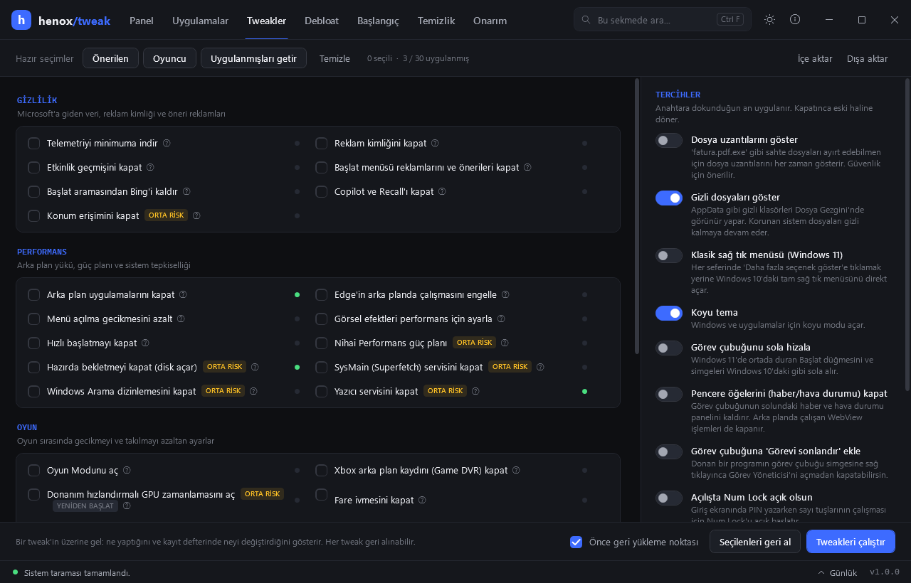

<div align="center">

# henox/tweak

**Türkçe WinUtil alternatifi: ücretsiz ve açık kaynak Windows kurulum ve iyileştirme aracı.**

Uygulamaları kur, tweakleri uygula, gereksizleri kaldır, sorunları onar.
Tek komut, tek pencere, her adım geri alınabilir.

[tweak.henox.dev](https://tweak.henox.dev) · [Kullanım Rehberi](https://tweak.henox.dev/rehber/) · [Tweak Gezgini](https://tweak.henox.dev/araclar/tweak-gezgini/) · [Hata bildir](https://github.com/Henox77/henox-tweak/issues)



</div>

## Kullanım

**Başlat** menüsüne sağ tıkla → **Terminal (Yönetici)** → şunu yapıştır:

```powershell
irm tweak.henox.dev/run | iex
```

Komut çalıştırmak istemiyorsan [henox.ps1](https://tweak.henox.dev/henox.ps1) dosyasını indir, sağ tıkla → **PowerShell ile çalıştır**.

Windows 10 (1809+) ve Windows 11'de çalışır.

## Neler yapabilir?

| Sekme | Ne yapar |
|---|---|
| **Panel** | Donanımını okur, RAM / disk doluluğunu ve açık kalma süresini ölçer, sana özel ve dürüst öneriler verir. |
| **Uygulamalar** | 74 popüler programı winget ile tek seferde, sessizce kur. Kurulu olanları işaretler, hepsini tek tıkla günceller. |
| **Tweakler** | 39 tweak: gizlilik, performans, oyun, Windows Update, gelişmiş. "Önerilen" ve "Oyuncu" hazır seçimleri. Sağda anında uygulanan tercihler ve DNS değiştirici. |
| **Debloat** | Önceden yüklü gereksiz Microsoft uygulamalarını kaldırır. Hangisinin güvenli olduğunu yazar. |
| **Başlangıç** | Açılışta kendiliğinden başlayan programları açıp kapatır (Görev Yöneticisi ile aynı yöntem). |
| **Temizlik** | Temp, Windows Update önbelleği, çökme dökümleri, GPU gölgelendirici önbellekleri. Önce tarar, sonra siler. |
| **Onarım** | SFC, DISM, Windows Update onarımı, ağ sıfırlama, simge önbelleği ve Windows araçları. |

Animasyonlu arayüz, açık / koyu tema (Windows temanı otomatik algılar), sekme içi arama (`Ctrl F`).

### Otomasyon

Seçimini **Dışa aktar** ile veya tarayıcıda [Yapılandırma Oluşturucu](https://tweak.henox.dev/araclar/yapilandirma/) ile kaydet, sonraki bilgisayarda tek komutla uygula:

```powershell
& ([scriptblock]::Create((irm tweak.henox.dev/run))) -Config "C:\henox-ayarlarim.json" -Run
```

## Güvenlik ilkeleri

- **Tek dosya, düz metin.** EXE, şifreli veya karıştırılmış kod yok. Çalışan dosya bu repodaki kaynaktan derlenir.
- **Defender, Güvenlik Duvarı ve UAC'ye asla dokunmaz.**
- **Hiçbir veri göndermez.** İnternete yalnızca winget ile uygulama kurarken çıkar.
- **Her şey geri alınabilir.** Uygulanan her tweak'in orijinal değeri `%ProgramData%\HenoxTweak\backup.json` dosyasına yazılır. İstersen işlemden önce Windows geri yükleme noktası oluşturur.
- **Her işlem günlüğe yazılır:** `%ProgramData%\HenoxTweak\logs\`

### Çalıştırmadan önce incele

```powershell
irm tweak.henox.dev/run -OutFile henox.ps1
notepad henox.ps1
Get-FileHash henox.ps1   # sitede yazan SHA256 ile karşılaştır
```

## Geliştirme

```
src/
  app.ps1        Arayüz mantığı, sekmeler, arka plan işleri
  core.ps1       Kayıt defteri, servis, yedekleme ve temizlik fonksiyonları
  window.xaml    WPF arayüz tasarımı, tema ve animasyonlar
  tweaks.json    Tweak tanımları
  apps.json      winget uygulama listesi
  debloat.json   Kaldırılabilir önceden yüklü uygulamalar
site/            tweak.henox.dev (ana sayfa, docs/ içerikleri, assets/)
build.mjs        Tek dosyalık public/henox.ps1'i ve siteyi derler
```

```bash
node build.mjs
powershell -ExecutionPolicy Bypass -File public\henox.ps1
```

Yeni tweak veya uygulama eklemek için: [Katkıda Bulunma](https://tweak.henox.dev/katki/).

## Teşekkür

[Chris Titus Tech'in WinUtil](https://github.com/ChrisTitusTech/winutil) projesinden ilham alınmış, sıfırdan yazılmış bağımsız bir Türkçe alternatiftir. WinUtil ve Chris Titus Tech ile resmi bir bağlantısı yoktur.

## Lisans

[MIT](LICENSE) © 2026 Henox. Bu yazılım "olduğu gibi" sunulur. Microsoft ile herhangi bir bağlantısı yoktur.
